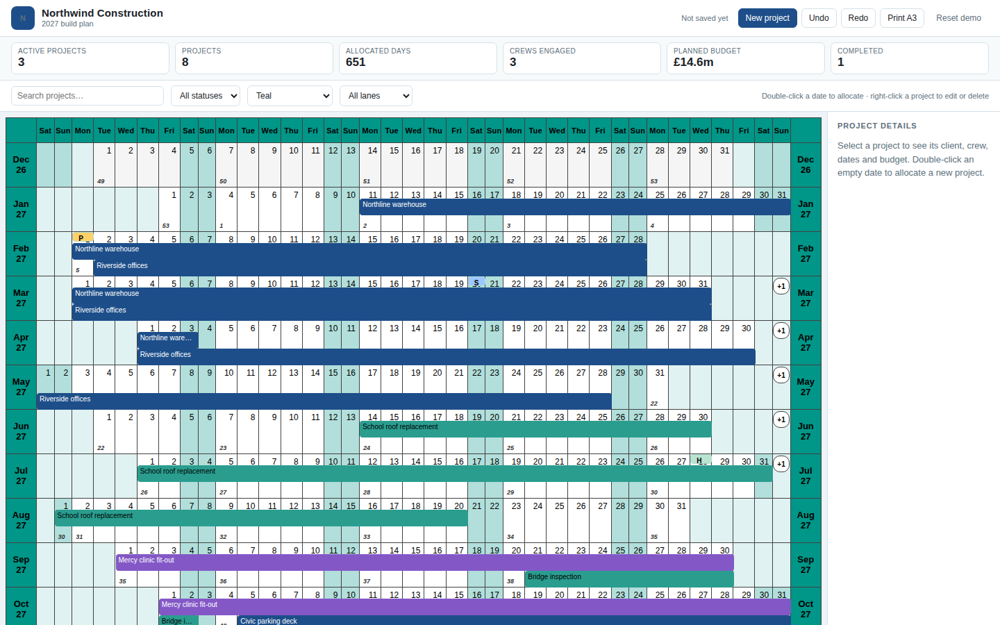
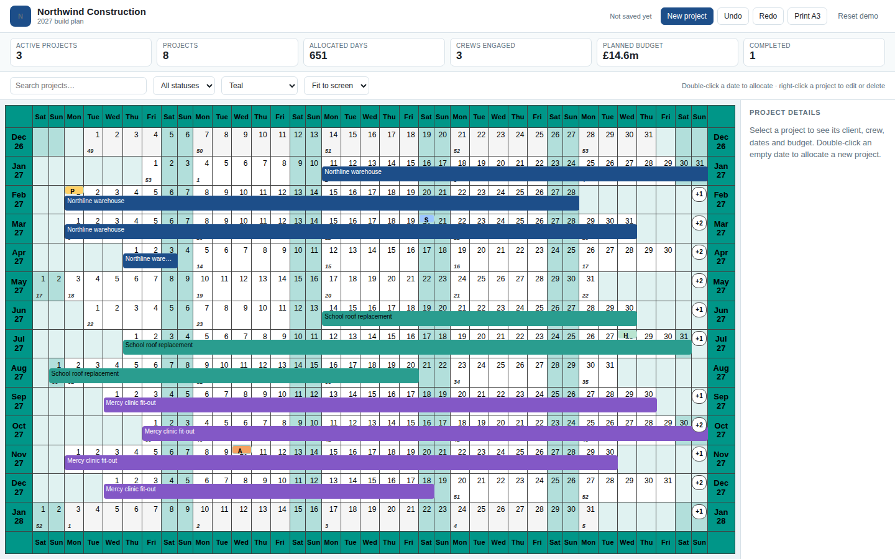
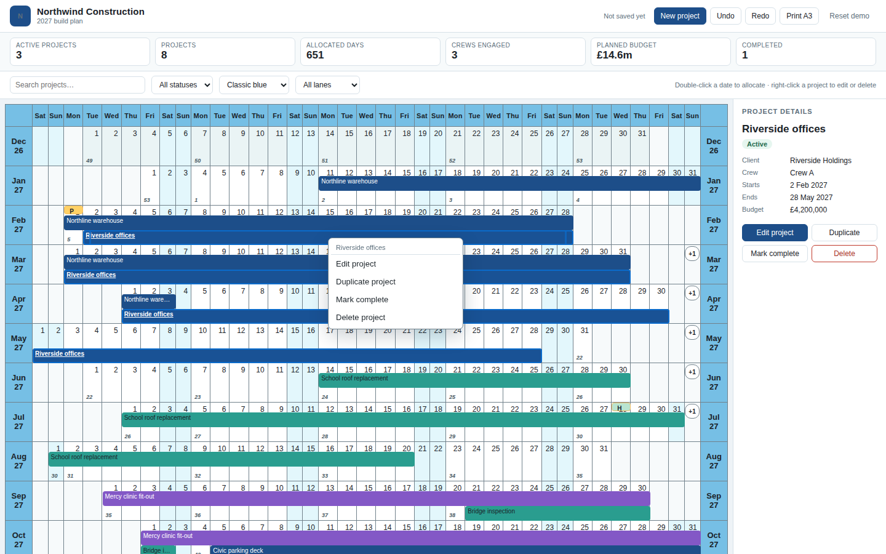

<p align="center">
  
</p>

<h1 align="center">Year Planner for React</h1>

<p align="center">
  <strong>Plan a whole year in one component.</strong><br />
  A 12–36 month, 37-column planning grid for construction, logistics, staffing
  and every team that plans a year at a glance.
</p>

<p align="center">
  <a href="https://github.com/blendsdk/year-planner/actions/workflows/ci.yml"></a>
  <a href="https://blendsdk.github.io/year-planner/"></a>
  <a href="https://blendsdk.github.io/year-planner/storybook/"></a>
  <a href="LICENSE"></a>
</p>



## Why Year Planner

| | |
| --- | --- |
| **12–36 months, 37 columns** — a classic Saturday-first year grid with context months, ISO week numbers and continuous ribbons across month rows. | **Fit to the host** — columns scale horizontally and rows choose a 24 px lane budget, so a 14-month view fits a laptop without shrinking hit targets. |
| **Built for 2,000 items** — one projection per model, a max-end lane index and row-scoped selection keep clicks fast. | **CSS-variable theming** — five presets, host token overrides and optional Fluent UI v9 and MUI adapters. |
| **Accessible by default** — a roving grid, live-region announcements, 24 px targets, reduced-motion support and automated axe coverage. | **A3 print output** — a hidden print tree paginates a 12–36 month window into one to three A3 landscape pages. |

| Fit to the host | Host-owned context menu |
| --- | --- |
|  |  |

## Quickstart

> **Status**: `0.3.0` is prepared but **not yet published** to npm. Use the
> packed-tarball install in the [getting-started guide](docs/getting-started.md)
> until the registry release. The API below is the intended published API.

```tsx
import { useState } from "react";
import type {
  PlannerItem,
  PlannerLayer,
  PlannerSelection,
  VisibilityState,
} from "@blendsdk/year-planner-core";
import { YearPlanner } from "@blendsdk/react-year-planner";
import "@blendsdk/react-year-planner/styles.css";

const layers: PlannerLayer[] = [
  { id: "build", name: "New build", channel: "ribbon", color: "#1d4e89" },
];

const items: PlannerItem[] = [
  {
    id: "riverside",
    kind: "activity",
    layerId: "build",
    period: { kind: "all-day", startDate: "2027-02-02", endDateExclusive: "2027-05-29" },
    title: "Riverside offices",
    version: 1,
  },
];

export function Plan() {
  const [selection, setSelection] = useState<PlannerSelection>({ dates: [], items: [] });
  const [visibility, setVisibility] = useState<VisibilityState>({
    hiddenGroupIds: [],
    hiddenLayerIds: [],
    hiddenItemIds: [],
  });

  return (
    <>
      <button type="button" onClick={() => window.print()}>
        Print A3
      </button>
      <div style={{ height: 680, minHeight: 0 }}>
        <YearPlanner
          year={2027}
          layers={layers}
          defaultItems={items}
          selection={selection}
          onSelectionChange={setSelection}
          visibility={visibility}
          onVisibilityChange={setVisibility}
        />
      </div>
    </>
  );
}
```

Give the planner a bounded parent; it measures that region for the fit. See
[Sizing and fit](https://blendsdk.github.io/year-planner/getting-started.html#sizing-and-fit).

## Documentation

| | |
| --- | --- |
| **[Website](https://blendsdk.github.io/year-planner/)** | Home, guide, tutorials, how-tos and examples |
| **[Getting started](https://blendsdk.github.io/year-planner/getting-started.html)** | Install, render, select and print |
| **[Tutorials](https://blendsdk.github.io/year-planner/tutorials/first-planner.html)** | First planner, controlled commands, theming and print |
| **[Examples](https://blendsdk.github.io/year-planner/examples/)** | Full demo, themes, print and design systems |
| **[Storybook](https://blendsdk.github.io/year-planner/storybook/)** | **184 stories across 16 files**, including the full demo |
| **[API reference](https://blendsdk.github.io/year-planner/api/)** | Generated TypeDoc for both packages |
| [Repository guides](docs/README.md) | Architecture, performance, security, test report and ADRs |

The public full demo is a working construction plan: double-click a date to
allocate a project, right-click a bar to edit or delete it, and reload to see
the plan restored from browser storage.

## Demo routes

Run `pnpm dev` for the private demo app. It supports `?commands=1`,
`?interaction=1`, `?security=1`, `?ac3=1` and `?print=prt01` for the controlled
commands, interaction, hidden-data, design-system and print samples.

## Packages

| Package | Purpose |
| --- | --- |
| `@blendsdk/year-planner-core` | Dates, layout, ribbons, hit index and print planning |
| `@blendsdk/react-year-planner` | React 19 component, interaction engine, renderer and adapters |

- **ESM only**, Node `>=20.19`, React 19 peer dependency.
- **MIT licensed**; contributions use the Developer Certificate of Origin.
- The packages are prepared at `0.3.0`; the first npm publication is pending.

## Development

```bash
pnpm install --frozen-lockfile
pnpm verify          # fast gate: typecheck, lint, unit, component, quality, build, docs
pnpm verify:full     # release gate: adds browser, timezone, audit, performance and consumer
pnpm storybook       # Storybook, opening on the full demo
pnpm docs:dev        # VitePress at http://localhost:5173/year-planner/
pnpm docs:site       # combined VitePress + Storybook + TypeDoc artifact
```

The site is designed for GitHub Pages at
`https://blendsdk.github.io/year-planner/`; there is no custom domain.

## Status

Pre-release: `0.3.0` is prepared but not yet on npm. The manual screen-reader
audit is pending, so there is no WCAG conformance claim. See
[Limitations](docs/limitations.md) for supported sizes and known gaps.

## Contributing

Read [CONTRIBUTING.md](CONTRIBUTING.md), follow the
[Code of Conduct](CODE_OF_CONDUCT.md), and sign off every commit (`git commit -s`).
Security reports belong in [SECURITY.md](SECURITY.md), not public issues.
[Open an issue or feature request](https://github.com/blendsdk/year-planner/issues/new/choose),
read [SUPPORT.md](SUPPORT.md), or see the [release guide](docs/releasing.md).
See [DEFERRED.md](DEFERRED.md) for capabilities that are explicitly not in this
release.

## License

[MIT](LICENSE). Third-party notices are in
[THIRD_PARTY_NOTICES.md](THIRD_PARTY_NOTICES.md).
