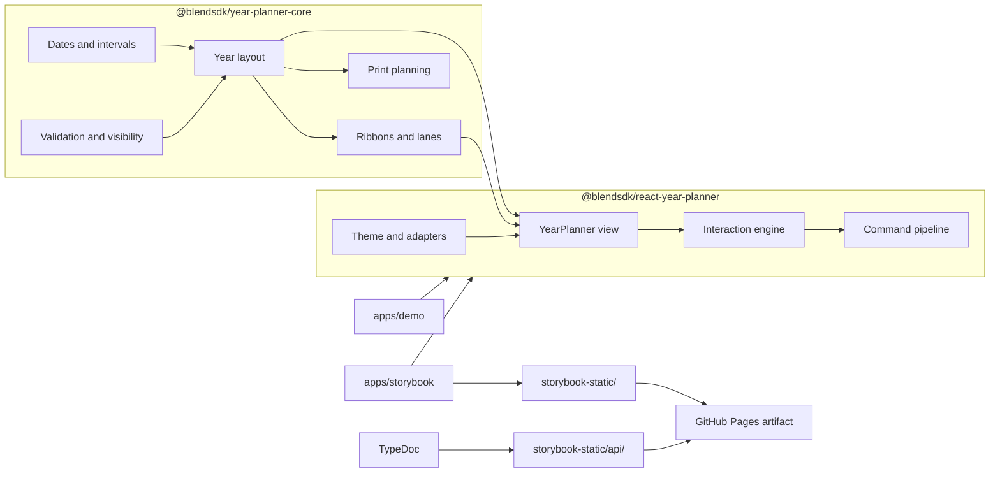

# Architecture

> **Scope**: the package boundaries and the documentation pipeline.

Year Planner for React is an ESM-only monorepo with two public packages and two
private apps:

- `@blendsdk/year-planner-core` — pure TypeScript dates, intervals, validation,
  visibility resolution, layout geometry, ribbon lanes, hit index and print
  planning. No React, no DOM.
- `@blendsdk/react-year-planner` — React view, interaction engine, command
  pipeline, renderer, theme provider, slots and design-system adapters.
- `apps/demo` — private integration demo and the benchmark route.
- `apps/storybook` — private component catalogue and the published site.

## Mermaid diagram

## Rules

- The core package never imports React or reads the DOM.
- The React package imports the core through the public package entry, never a
  deep path.
- The adapters (`adapters/fluent`, `adapters/mui`) accept plain theme objects and
  declare no design-system peer dependency.
- Storybook and the demo consume the public packages; they are private and are
  not published.
- TypeDoc reads the package entry points and the checked-in TSDoc; API Extractor
  protects the same surface.

## Related

- [ADR 0001](adr/0001-renderer-strategy.md) — the HTML/CSS renderer decision.
- [Documentation index](README.md) — the guide map.
- [Test report](test-report.md) — the measured evidence.
